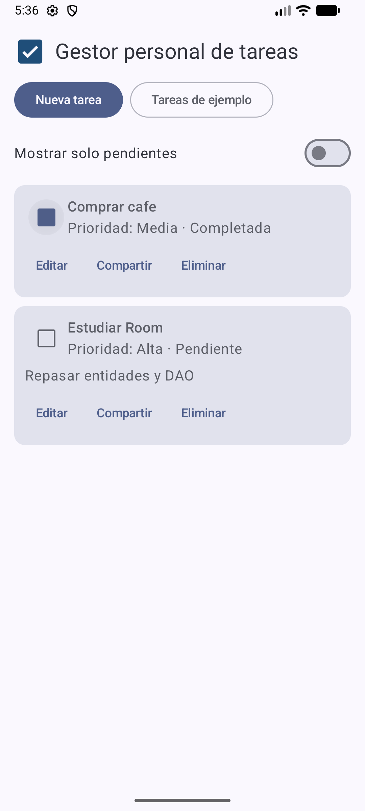
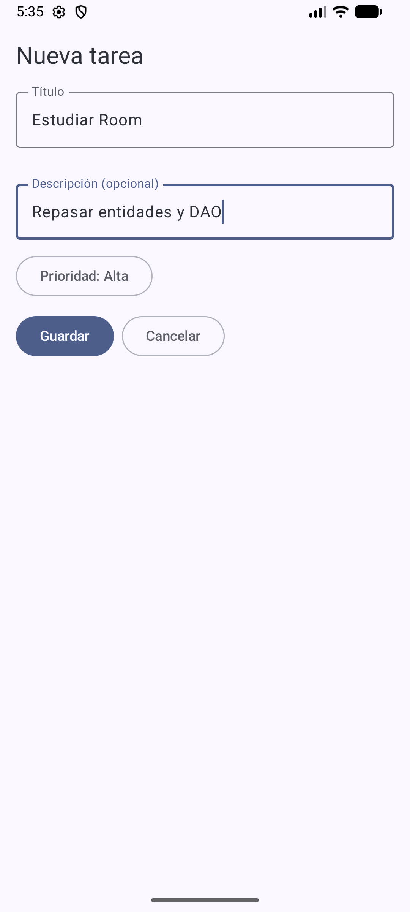
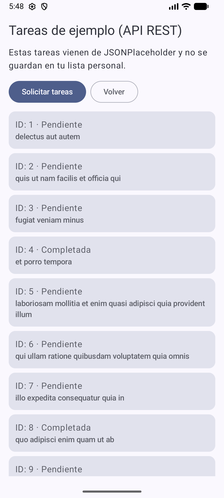
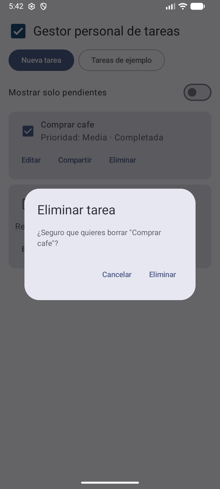

## Módulo: Programación Multimedia y Dispositivos Móviles

* Autor: *Guillermo Eugui Sánchez*

* Fecha: *13/11/2026*

* Versión: *1.0.0*

# Gestor Personal de Tareas

Aplicación Android hecha con Kotlin y Jetpack Compose para apuntar tareas personales, de clase o del trabajo, editarlas, marcarlas como hechas y borrarlas. Los datos se guardan en el teléfono con Room y el filtro de pendientes con DataStore. También tiene un apartado separado para pedir tareas de prueba a una API pública y opción para compartir tareas por otras apps.

## Estructura de la entrega

- `README.md`: documentación principal de la práctica.
- `img/`: capturas de pantalla de la aplicación funcionando en el emulador.
- `GestorTareas/`: proyecto completo de Android Studio en Kotlin.

## Qué hace la app

- Lista principal con título, descripción, prioridad (`Baja`, `Media`, `Alta`) y estado (`Pendiente` o `Completada`).
- Botón para crear tareas nuevas y formulario con validación del título (no vacío y mínimo 3 caracteres reales tras quitar espacios).
- Bloqueo del botón guardar mientras escribe en la base de datos para no duplicar filas al pulsar rápido.
- Edición de cualquier tarea manteniendo su identificador.
- Checkbox para cambiar entre pendiente y completada directamente desde la lista.
- Diálogo de confirmación (`AlertDialog`) antes de borrar una tarea.
- Switch **Mostrar solo pendientes** guardado en Preferences DataStore (por defecto desactivado).
- Apartado **Tareas de ejemplo** conectado con Retrofit a `https://jsonplaceholder.typicode.com/todos?userId=1`, mostrando indicador de carga, resultados, aviso si no hay red y botón de reintento.
- Botón **Compartir** que prepara un texto con título, descripción y prioridad y abre el selector del sistema con `ACTION_SEND`.

## Cómo está organizado el código

Todo el código fuente está dentro de `GestorTareas/app/src/main/java/com/example/gestortareas/`:

- `Tarea.kt`: entidad Room que representa la tabla `tareas`.
- `TareaDao.kt`: consultas e inserción, actualización y borrado con `Flow` y funciones `suspend`.
- `AppDatabase.kt`: base de datos Room (`tareas.db`) con instancia única.
- `Ajustes.kt`: lectura y escritura del filtro en Preferences DataStore (`ajustes`).
- `ApiTareas.kt`: modelo `TareaRemota`, interfaz Retrofit `ApiTareas`, cliente `ServicioTareas`, estados `EstadoCarga` y función `cargarTareas`.
- `Pantallas.kt`: validaciones, función de compartir con `Intent` y las pantallas Compose (`AppGestorTareas`, `PantallaLista`, `PantallaFormulario`, `PantallaTareasRemotas`).
- `MainActivity.kt`: obtiene el `TareaDao` al arrancar y monta la interfaz dentro de `Scaffold`.

En recursos está `GestorTareas/app/src/main/res/drawable/icono_tarea.xml` como icono local para la cabecera y `GestorTareas/app/src/main/AndroidManifest.xml` declara el permiso `INTERNET`.

## Bibliotecas usadas

- Jetpack Compose y Material 3 (BOM `2026.02.01`)
- Lifecycle Runtime Compose `2.11.0`
- Room `2.8.4` (`room-runtime`, `room-ktx` y `room-compiler` con KSP `2.3.14`)
- Preferences DataStore `1.3.0`
- Retrofit `3.0.0` y `converter-gson` `3.0.0`
- Coroutines de Kotlin

## Cómo abrir y ejecutar el proyecto

1. Abre la carpeta `GestorTareas/` en Android Studio y deja que Gradle sincronice las dependencias.
2. Para ejecutar en emulador o móvil por USB (con depuración USB activa), selecciona el módulo `app` y pulsa **Run**.
3. Para generar el APK de depuración desde la terminal en Windows PowerShell:

```powershell
cd GestorTareas
.\gradlew.bat assembleDebug
```

El archivo queda generado en `GestorTareas/app/build/outputs/apk/debug/app-debug.apk`. Para instalarlo por ADB en un emulador o teléfono conectado:

```powershell
adb install -r GestorTareas/app/build/outputs/apk/debug/app-debug.apk
```

## Emuladores y tamaños probados

Las pruebas se ejecutaron en el emulador `Medium_Phone_API_37.0` de Android Studio y, además, se comprobó la distribución de pantalla en tamaño compacto y en tamaño grande ajustando resolución y densidad con ADB (`wm size` / `wm density`):

| Entorno | Perfil | Resolución | Densidad | API |
| :--- | :--- | :--- | :--- | :--- |
| Emulador principal | Medium Phone API 37.0 (AVD) | 1080 x 2400 px | 420 dpi | API 37 |
| Perfil compacto probado | Simulado con `wm size` / `wm density` | 720 x 1280 px | 320 dpi | API 37 |
| Perfil pantalla grande probado | Simulado con `wm size` / `wm density` | 2560 x 1600 px | 320 dpi | API 37 |

## Matriz de pruebas obligatorias

| Nº | Prueba | Resultado esperado | Resultado observado | Estado |
| :- | :--- | :--- | :--- | :--- |
| 1 | Crear una tarea válida | Se guarda y aparece en la lista. | Se guardó «Estudiar Room» (prioridad Alta) y «Comprar cafe», apareciendo ambas en `LazyColumn`. | Correcto |
| 2 | Intentar guardar un título vacío | Se muestra un error y no se crea la tarea. | Se mostró «El título no puede estar vacío» bajo el campo y no se guardó nada (también cubierto en `ExampleUnitTest`). | Correcto |
| 3 | Editar una tarea | Los cambios se muestran correctamente. | Se editó «Estudiar Room» a «Estudiar Room y SQLite» y la lista mostró el cambio. | Correcto |
| 4 | Marcar una tarea como completada | Su estado cambia y queda guardado. | Al marcar el `Checkbox` de «Comprar cafe», su estado pasó a «Completada». | Correcto |
| 5 | Cancelar una eliminación | La tarea no desaparece. | Al pulsar «Cancelar» en el `AlertDialog`, «Comprar cafe» siguió en la lista. | Correcto |
| 6 | Eliminar una tarea confirmando | La tarea desaparece de la base de datos. | Al confirmar «Eliminar», «Comprar cafe» desapareció y solo quedó «Estudiar Room y SQLite». | Correcto |
| 7 | Cerrar y volver a abrir la aplicación | Se recuperan las tareas guardadas. | Tras `am force-stop` y volver a abrir la app, se recuperó «Estudiar Room y SQLite» desde Room. | Correcto |
| 8 | Activar el filtro y reiniciar | Se conserva la preferencia seleccionada. | Con «Mostrar solo pendientes» activado, tras `am force-stop` y reabrir siguió activo y ocultó la completada. | Correcto |
| 9 | Consultar la API con Internet | Se muestran las tareas recibidas. | Se cargaron las tareas de `JSONPlaceholder` (como `ID: 1 · Pendiente`, «delectus aut autem»). | Correcto |
| 10 | Consultar la API sin conexión | Se muestra un error y se permite reintentar. | Con Wi-Fi y datos desactivados apareció «No se pudo conectar. Inténtalo de nuevo» y el botón «Reintentar». | Correcto |
| 11 | Compartir una tarea | Se abre el selector de aplicaciones compatibles. | Al pulsar «Compartir» se abrió el selector del sistema (`intentresolver`) con el texto de la tarea. | Correcto |
| 12 | Cambiar la orientación del dispositivo | Sigue funcionando y conserva los datos. | Al girar a horizontal (`2400 x 1080`) la interfaz se adaptó y siguió mostrando la tarea guardada. | Correcto |

## Capturas de pantalla

### 1. Listado principal


### 2. Formulario de creación / edición


### 3. Consulta a la API REST


### 4. Diálogo de confirmación al eliminar


## Chat de IA usado en el desarrollo

- Enlace al chat de apoyo: [ENLACE GEMINI](https://share.gemini.google/Q0n3KP11IyC5).

## Incidencias y límites conocidos

- Las pruebas de tamaño compacto (`720 x 1280`) y pantalla grande (`2560 x 1600`) se comprobaron sobre el mismo AVD `Medium_Phone_API_37.0` cambiando resolución y densidad por ADB, en lugar de crear un segundo AVD independiente.
- Las tareas de ejemplo de la API no se guardan en Room ni se editan en remoto, tal como pide el enunciado.
